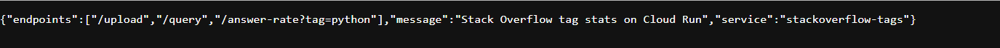
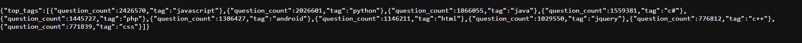
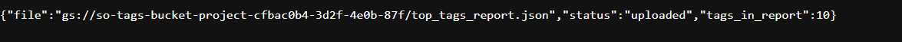
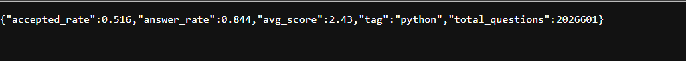
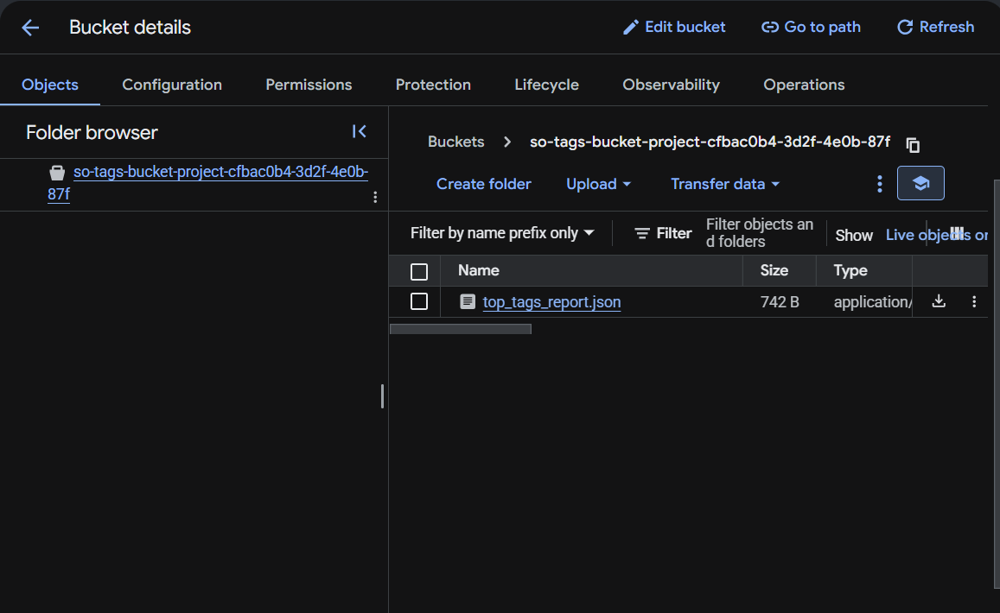
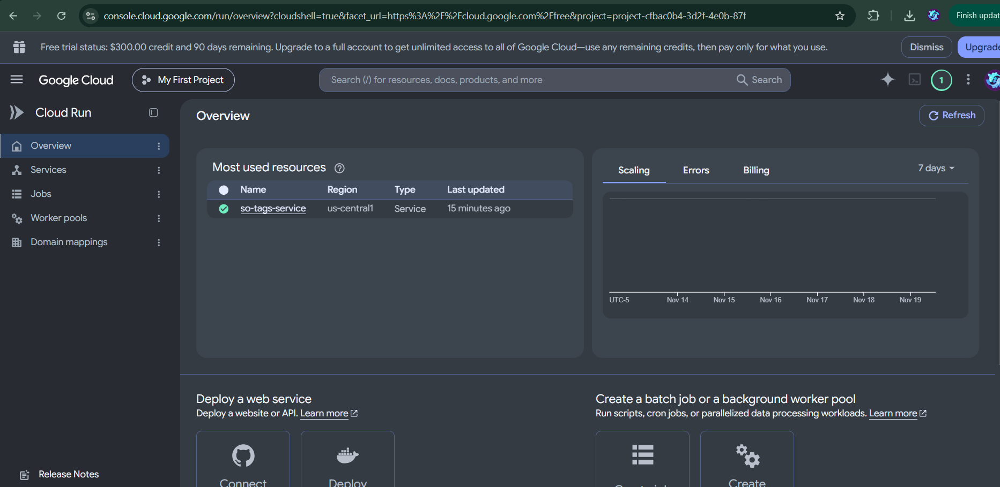

# MLOps Lab: Cloud Run with BigQuery and Cloud Storage

DADS7305, Northeastern University
Jaiyashree

A small Flask API deployed on Google Cloud Run. It queries the public Stack Overflow dataset in BigQuery and saves a report to a Cloud Storage bucket.

## Endpoints

| Endpoint | What it does |
|---|---|
| `GET /` | service info and list of endpoints |
| `GET /query` | top 10 Stack Overflow tags by number of questions |
| `GET /upload` | runs the top tags query and saves it as `top_tags_report.json` in the bucket |
| `GET /answer-rate?tag=python` | for one tag: total questions, share answered, share with an accepted answer, average score |

`/answer-rate` uses BigQuery query parameters, so the tag value is never pasted into the SQL string. A tag with no questions returns 404.

Note: the public Stack Overflow dataset is a historical snapshot, so the numbers are not live.

## Changes from the original lab

- Stack Overflow dataset instead of the lab's example data
- `/upload` writes live query results to the bucket instead of a static file
- New parameterized endpoint `/answer-rate`
- Dedicated service account with only the roles it needs (`bigquery.jobUser`, `storage.objectAdmin` on the bucket)

## Deploy

Run in Cloud Shell:

```
export PROJECT_ID=your-project-id
export BUCKET=so-tags-bucket-$PROJECT_ID
export REGION=us-central1
gcloud config set project $PROJECT_ID

gcloud services enable run.googleapis.com storage.googleapis.com bigquery.googleapis.com artifactregistry.googleapis.com

gcloud storage buckets create gs://$BUCKET --location=$REGION
gcloud iam service-accounts create so-tags-sa
gcloud projects add-iam-policy-binding $PROJECT_ID --member="serviceAccount:so-tags-sa@$PROJECT_ID.iam.gserviceaccount.com" --role="roles/bigquery.jobUser"
gcloud storage buckets add-iam-policy-binding gs://$BUCKET --member="serviceAccount:so-tags-sa@$PROJECT_ID.iam.gserviceaccount.com" --role="roles/storage.objectAdmin"

gcloud artifacts repositories create so-tags-repo --repository-format=docker --location=$REGION
gcloud auth configure-docker $REGION-docker.pkg.dev
docker build -t $REGION-docker.pkg.dev/$PROJECT_ID/so-tags-repo/so-tags-app .
docker push $REGION-docker.pkg.dev/$PROJECT_ID/so-tags-repo/so-tags-app

gcloud run deploy so-tags-service --image $REGION-docker.pkg.dev/$PROJECT_ID/so-tags-repo/so-tags-app --region $REGION --allow-unauthenticated --service-account so-tags-sa@$PROJECT_ID.iam.gserviceaccount.com --set-env-vars BUCKET_NAME=$BUCKET
```

## Screenshots

Home:



Top tags:



Upload:



Answer rate:



Report in the bucket:



Cloud Run service:


